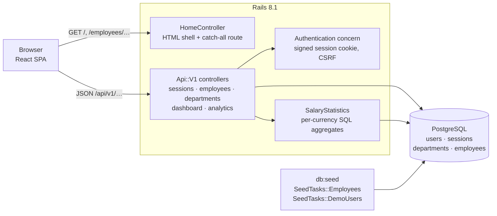
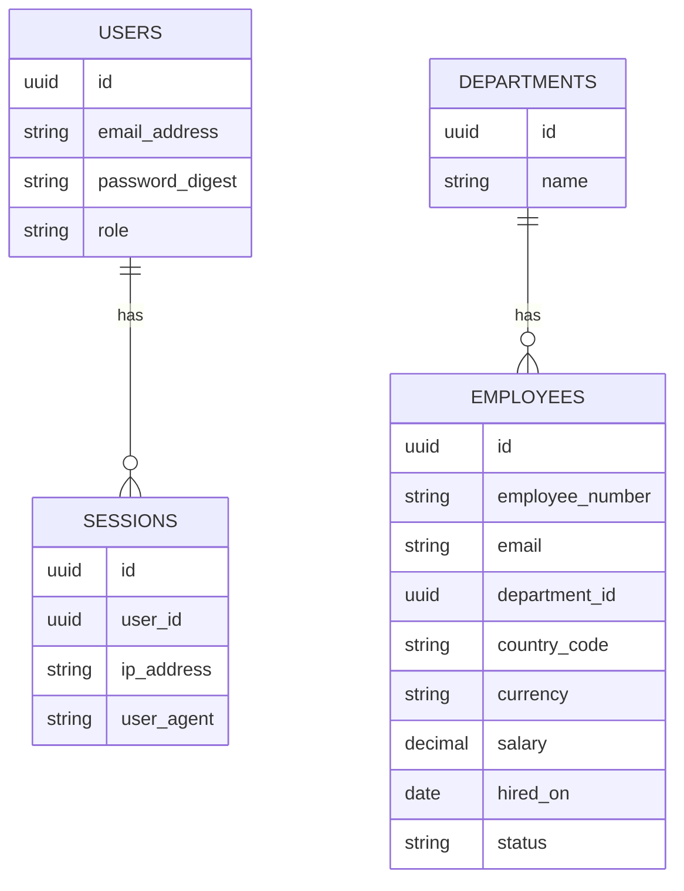

# Architecture

One Rails 8.1 application serves both the JSON API and the React single-page app. There is
one deployable unit, one database, and no separate frontend server outside development.

## Request flow

- Any non-API HTML request (`/`, `/employees/123`, `/analytics?group_by=country`) hits
  `HomeController#index` through a catch-all route, which returns the HTML shell with the
  Vite bundle and the CSRF meta tag. React Router then renders the page on the client.
  The catch-all excludes `/api`, so unknown API paths still return JSON 404s.
- The SPA calls `/api/v1/*` with Axios. In development, `bin/vite dev` serves the bundle
  with hot reload; in production, Rails serves the built assets.

## Backend

| Part | Responsibility |
|---|---|
| `Api::V1::BaseController` | JSON 401 / 403 / 404 / 400 responses, `require_admin` |
| `SessionsController` | Sign in, current user, sign out; rate-limited sign-in |
| `EmployeesController` | Index (search, filters, sort, pagination), show, update salary (admin only) |
| `DepartmentsController` | Departments with employee counts, for the filter list |
| `DashboardsController`, `AnalyticsController` | Headcount and statistics via `SalaryStatistics` |
| `SalaryStatistics` | Min / average / median / max and headcount, grouped by currency, optionally by department or country within each currency |
| `SeedTasks::Employees`, `SeedTasks::DemoUsers` | Deterministic seed data and demo accounts |

### Data model

- UUID primary keys everywhere; enums (`role`, `status`) are stored as strings.
- `salary` is `numeric(14,2)` with a database check that it is positive.
- `country_code` and `currency` are independent columns: an employee in Germany can be
  paid in USD.
- Indexes: unique on `employee_number` and `email`; B-tree on the filter columns and on
  name; trigram GIN indexes for search (see [PERFORMANCE.md](PERFORMANCE.md)).

### Authentication and authorisation

- Built on the Rails 8.1 authentication generator, adapted to JSON: `has_secure_password`
  (bcrypt), a `Session` row per sign-in, and a signed, `httponly`, `SameSite=Lax` cookie
  holding the session id.
- Every endpoint except sign-in requires a session; unauthenticated requests get JSON 401.
- CSRF protection is on: non-GET requests send the token from the page's
  `<meta name="csrf-token">` in an `X-CSRF-Token` header.
- Roles: `viewer` reads everything; `admin` can also update salaries. The check is on the
  server (`require_admin`); the UI only hides the edit control.

## Frontend

`app/javascript/src`:

| Folder | Contents |
|---|---|
| `api/` | One Axios client (CSRF header, 10 s timeout, errors normalised to `ApiError` with fixed messages) and one function per endpoint |
| `contexts/`, `hooks/useSession` | Session state: loading / signed out / signed in / error |
| `hooks/` | `useApiData` (shared loading: abort, errors, retry, 401 handling), thin per-page hooks on top of it (`useEmployees`, `useEmployee`, `useDashboard`, `useAnalytics`, `useDepartments`), and URL state (`useEmployeeQuery`) |
| `pages/` | Directory, employee detail, dashboard, analytics |
| `components/` | App shell, sign-in form, directory table / filters / pagination, salary editor, statistics table, error alert |
| `constants/`, `lib/`, `types/` | Filter option lists, formatting helpers, API types |

- **The URL is the source of truth** for the directory (search, filters, sort, page) and
  for the analytics grouping, so views can be bookmarked, shared and navigated with Back.
- **Requests are cancellable**: each data hook aborts its request when its inputs change or
  the page unmounts, so a slow old response cannot overwrite a newer one.
- **Session expiry**: any 401 from a data request signs the user out with a notice.
